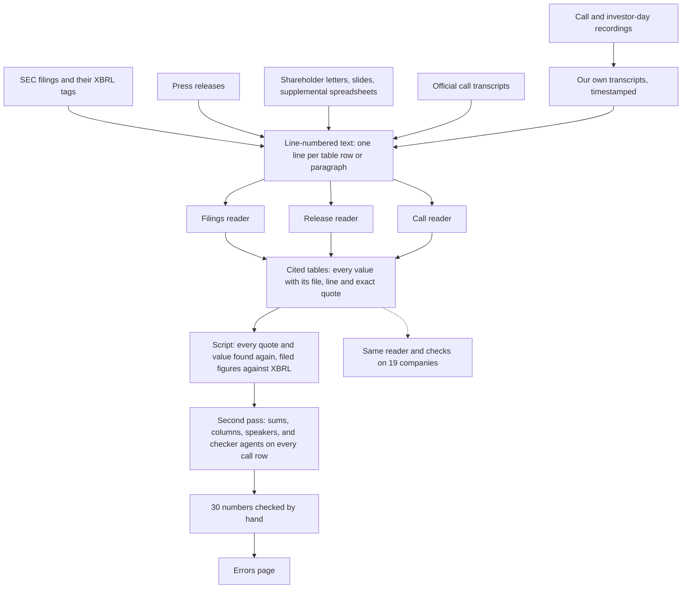

# AI Earnings Research

**Reading a company's earnings from the raw sources, with AI agents held to strict rules: every number cited to its
exact line, and every citation checked again.**

One company, Zscaler (ZS), and the four quarters of its fiscal 2026 (to July 31, 2026), read end to end from the
documents themselves:
- the SEC filings and their XBRL tags;
- the press releases;
- the company's shareholder letters, slides and supplemental spreadsheets;
- the official transcripts of four earnings calls;
- our own transcripts of the Q4 call and the 3.5-hour investor day.

Three reader agents turned these documents into tables in which every number points to its file, its line and the
exact words it came from. Scripts, a second reading and a hand check then tested every row. The same reading and
checks were then run on a 19-company cybersecurity group.

The owner designed the process and its rules ([CRITERIA.md](CRITERIA.md)) and directed the AI agents one step at a
time. Analysis, not investment advice.

## How it works

## In numbers

| | |
|---|---|
| Sources | 12 SEC filings (three 10-Qs, the 10-K, eight 8-Ks), 4 press releases, 3 shareholder letters, 4 supplemental financial packs, 2 slide decks, 4 official call transcripts, and 4.5 hours of audio we transcribed ourselves |
| Reader tables | 532 filed figures and 60 filing changes; 422 release rows (results, guidance, reconciliations, consensus); 720 call statements, 81 analyst questions, 43 changes in management's wording |
| Citations found again by script | 1,983 of 1,983 quotes exactly on their cited line; 1,452 of 1,452 values inside their quote |
| Filed figures against XBRL | 562 match, 0 contradicted |
| Second pass by script | reconciliations 35/35, margins 15/15, right column 209/209, consensus 36/36, speaker labels 642/642; 2 planted errors both caught |
| Checker agents | 904 rows that need judgment, each read next to its source line: 17 flags, 13 rows fixed, none of them a wrong number |
| By hand | 30 of 30 numbers right, drawn with a fixed seed from the rows no script could confirm |

## What the sources got wrong

- **Two downloads of the same SEC data disagreed.** Copies of the filing list taken two weeks apart gave acceptance
  times four hours apart, exactly the gap between UTC and New York time. The fresh copy fits the releases, just after
  the close. Every file is now kept with its fetch time and checksum.
- **A web search summary called the ARR guidance "revenue".** FY27 ARR is guided to $4.396-4.426B; revenue to
  $3.908-3.938B.
- **Our own transcript heard "$20 billion" where the slide says $220B.** The call reader caught it against the deck.
- **The official transcript credited the CFO with an answer to a question put to the CEO**, and wrote "fiber-based
  SaaS" for what the deck calls a firewall-based SASE platform.
- **The company's own documents had errors.** Per-share EPS guidance was printed as "$3.78 to $3.82 million", and one
  supplemental spreadsheet's year-to-date columns added up the wrong quarters.
- **A metric changed meaning without a bridge.** "AI Security ARR" passed $400M on one call; the investor day put
  "Security for AI" at about $70M under new categories, and nothing reconciles the two.
- **Headline growth included an acquisition.** ARR grew 25%, but 20% without Red Canary, bought in the first quarter.

## What the agents got wrong

- **Nothing a script could see.** Every quote, value and filed figure checked out.
- **The call reader had one habit: overstating.** A hedge was dropped, "a big part" became "mostly", an inference was
  written as if it had been said. 13 of the 844 transcript-based rows were fixed; no number was wrong.
- **The second-opinion models kept to the brief's list word for word.** Both skipped 12 product metrics the brief did
  not name, so the revised form now names every metric.
- **The checker agents were wrong too**, on 2 of their 17 flags. A flag counts only once it has been checked against
  the source.

All of it, with citations, is in [4_checks/ERRORS.md](4_checks/ERRORS.md).

## Where to look

| | |
|---|---|
| [CRITERIA.md](CRITERIA.md) | The rules behind the report, each with its reason and what it caught |
| [1_sources/](1_sources/README.md) | What was collected, and how each file is kept exactly as fetched |
| [2_transcripts/](2_transcripts/README.md) | The official and our own transcripts, what was read from them, and how they were checked |
| [3_readers/](3_readers/README.md) | The readers' form, one reader per source, a sample of cited rows |
| [4_checks/](4_checks/README.md) | Every check and its result, the 30-number hand check, the fixes, the errors page |
| [5_comparison/](5_comparison/README.md) | The same process on a 19-company cybersecurity group: one page per company and a comparison table |

## Not in this repo

- **The source files.** They belong to the company, the SEC or a data vendor, and the official call transcripts are
  licensed for local use and short quotes only. The pages describe them and quote a few short lines.
- **The full tables.** Samples only.
- **A driver model and a one-page note** built on these tables are in progress and not published.

## Built with

Python's standard library (plus pypdf and openpyxl to read PDFs and spreadsheets), the SEC's EDGAR and XBRL data,
Whisper large-v3 on a local GPU, AI agents as readers and checkers (Codex CLI among them), and an AI coding agent
running each step on the owner's go-ahead.
